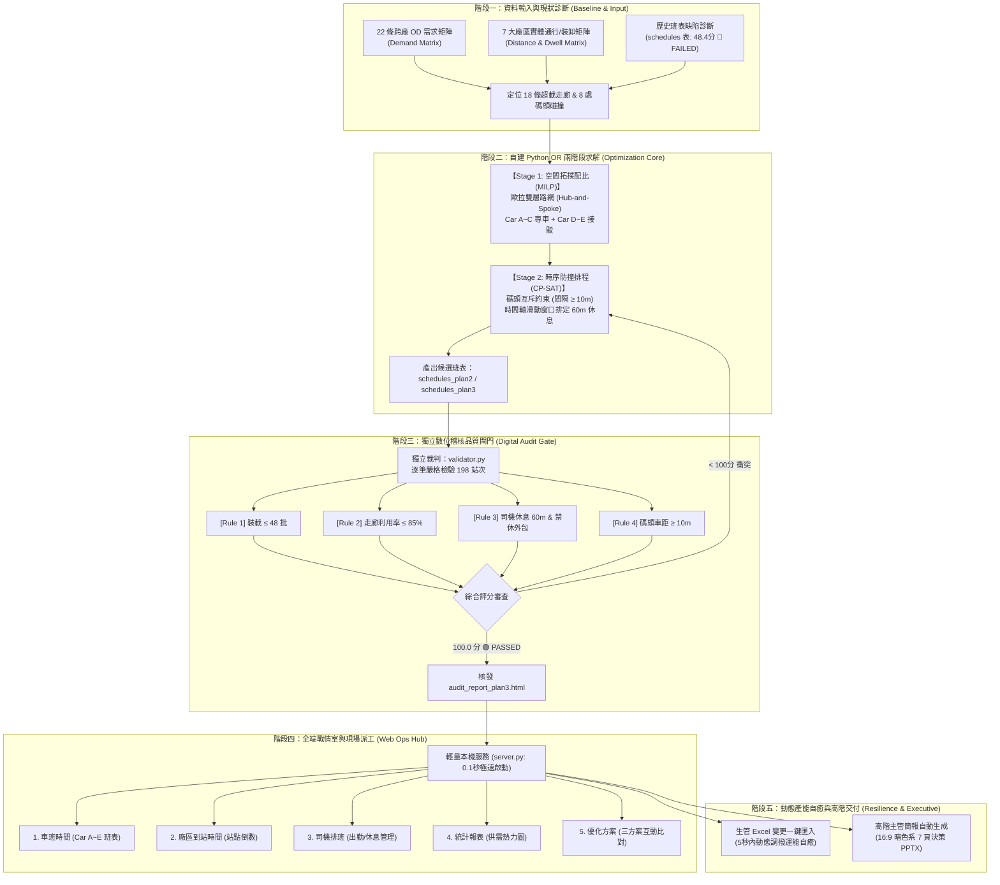

# 半導體廠區跨廠物流排程優化系統：端到端工作流手冊 (Project Workflow)

> **版本**：v1.0 (Production-Ready)  
> **適用角色**：運籌主管、生管調度員、現場車隊管理員、AI Agent 協同工程師  
> **核心引擎**：Google Gemini 1.5 Pro + Antigravity AI Agent + Python 自建 OR 求解器 + 獨立數位稽核機 (`validator.py`)

---

## 壹、 專案核心工作流程總覽 (High-Level Architecture)

本專案建立了標準的**五階段閉環閉合工作流（Five-Phase Closed-Loop Workflow）**，從問題診斷、演算法求解、品質閘門稽核、戰情室視覺化到高層決策簡報，實現了 100% 數據驅動與自動化：



---

## 貳、 具體執行步驟手冊 (Step-by-Step SOP)

### 步驟 1：啟動戰情室與本地環境 (Initialization)

本系統採 **極簡零依賴架構（Zero External Dependency）**，無需連外網、無需安裝 Docker/Node.js/SQL Server：
1. **一鍵啟動**：
   * 在 Windows 檔案總管雙擊：`啟動網站.bat`
   * 或於 PowerShell 終端機執行：
     ```bash
     python server.py
     ```
2. **存取介面**：
   * 本機瀏覽器開啟：`http://localhost:5000`
   * 進入具備 8 大導航功能之現代化物流戰情中心。

---

### 步驟 2：資料庫架構與版本控管 (Database Schema)

資料儲存於單一 SQLite 資料庫 `logistics.db`，核心資料表包含：
* **`schedules`**：原始歷史基準班表（236 趟次，全日運能 6,000 批，評分 48.4 分 🔴 FAILED）。
* **`schedules_plan2`**：初步雙層路網重構班表（198 趟次，運能 7,776 批，評分 93.3 分 🟡 WARNING，存在 6 處工時微衝突）。
* **`schedules_plan3`**：**正式生產線班表（190/198 趟次，100.0 分 🟢 PASSED，0 違規，全面合規上線）**。
* **`driver_roster`**：11 月份司機輪值表（Car A~E 日夜班 12 小時二班制）。
* **`od_demands`**：22 條走廊全日 5,742 批之基礎搬運需求。

---

### 步驟 3：運行 Python OR 求解與獨立稽核 (Optimization & Audit)

當現場需求變更，或需要重新生成排程時，工作流如下：

```bash
# 1. 執行演算法重構求解 (生成方案三)
python optimizer_plan3.py

# 2. 啟動獨立數位稽核品質閘門
python validator.py --table schedules_plan3 --report audit_report_plan3.html
```

#### 嚴格稽核標準（品質閘門通過條件）：
1. **[HARD-1] 車輛負載上限**：每一在途路段之載重嚴格 $\le 48$ 批（100% 裝載率）。
2. **[HARD-2] 走廊利用率紅線**：22 條走廊需求/供給比全數 $\le 85.0\%$，保留 $\ge 15\%$ 抗震裕度。
3. **[HARD-3] 司機法規休息**：日/夜班內足額 60 分鐘午晚餐休息，車輛移至專屬停車區、**嚴禁於外包廠（嘉晶）休息且不佔用裝卸碼頭**。
4. **[HARD-4] 實體時間不可壓縮**：跨廠行車時間（5~15 分鐘）與裝卸時間（5~15 分鐘）完全符合廠區實測物理極限。
5. **[SOFT-1] 碼頭互斥防撞**：同一碼頭兩車進站間隔嚴格 $\ge 10$ 分鐘（衝突件數歸零）。

---

### 步驟 4：動態需求自癒與 Excel 重算 (Dynamic Adaptation)

* **情境**：各廠機台突發產能變動（如總需求變動至 5,542 批，CD➔E 走廊突增 100 批）。
* **操作流程**：
  1. 調度員於戰情室「優化方案」頁面，點擊 **「匯入最新需求 Excel」**。
  2. 系統在 5 秒內完成 22 條走廊壓力測試，自動自富餘走廊（FAB8F➔8S）抽調運力補足 CD➔E。
  3. 自動觸發時序防撞微調，重新達成 100.0 分合規並即時刷新戰情室。

---

### 步驟 5：一鍵生成與匯出高階決策簡報 (Executive Delivery)

* 系統內建簡報自動化模組，將現場最新運行數據與演算法規格一鍵輸出為 16:9 寬螢幕 PowerPoint：
  ```bash
  python scratch/generate_clean_slides.py
  ```
* **產出成果**：
  * 檔案：`半導體廠區物流排程優化_高階主管報告與演算法規格.pptx`
  * 頁數：完整 7 頁（痛點診斷、實戰壓力測試、路網規格、雙層演算法、敏捷交付模式、AI Agent 部署架構、自建 OR 算力與商業替代方案比較）。

---

## 參、 系統架構與技術棧規格對照

| 模組分層 | 採用技術與核心工具 | 角色與職責 |
| :--- | :--- | :--- |
| **推理大腦** | **Google Gemini 1.5 Pro** | 消化廠區複雜運籌規則、設計雙層拓撲解耦邏輯、編寫核心代碼。 |
| **智慧代理** | **DeepMind Antigravity Agent** | 具備實體作業能力之虛擬工程師，自主執行終端指令、除錯修復與全鏈路交付。 |
| **運籌算力** | **自建 Python OR 求解引擎** | • 歐拉雙層路網 (Hub-and-Spoke)<br>• 時間軸滑動窗口 CSP 求解器<br>• 排隊論等候時間模擬器 (Queueing Model) |
| **品質閘門** | **`validator.py` 數位稽核機** | 脫離主演算法之獨立客觀裁判，對 198 站次進行 6 大硬約束與 2 大軟約束逐筆驗算。 |
| **資料儲存** | **SQLite 3 (`logistics.db`)** | 本地單一 ACID 資料庫，零組態維護，支援多方案即時比對與快速切換。 |
| **前後端服務** | **Python 原生 HTTP + HTML5/Chart.js** | 0.1 秒極速啟動，100% 離線封閉運作，提供 8 大導航看板與 REST API。 |

---

## 肆、 異常排查與常見問題 (Troubleshooting)

1. **連接埠 5000 被佔用**：
   * 執行指令查詢並釋放 Port：
     ```powershell
     Get-Process -Id (Get-NetTCPConnection -LocalPort 5000).OwningProcess | Stop-Process -Force
     ```
2. **簡報 PPTX 檔案無法儲存（Permission Denied）**：
   * 原因：PowerPoint 正在開啟該簡報檔案導致 Windows 檔案鎖定。
   * 解法：關閉本機 PowerPoint 軟體後重新執行腳本即可。
3. **現場排程出現違規警告**：
   * 隨時呼叫稽核機查閱詳細違規紀錄：
     ```bash
     python validator.py --table schedules_plan3
     ```
   * 稽核機將精確指出是哪一部車、在哪個時間點違反了碼頭車距或司機休息規範。
